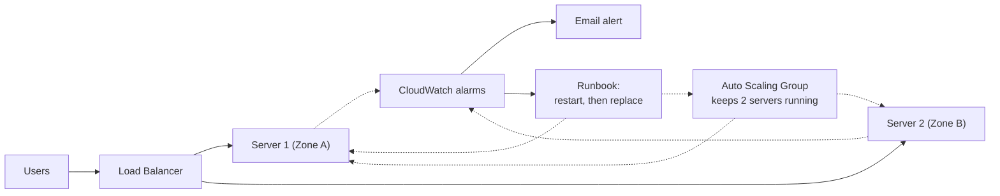

# 🛠️ Self-Healing AWS Infrastructure

> What if your servers could fix themselves at 3 AM?

This project is a small web app on AWS that **notices when a server breaks and repairs itself**, with no one logging in to fix it. Everything is written as code (CloudFormation), so the whole setup can be created, or deleted, in a few clicks.

**Built with:** EC2 · Auto Scaling · Load Balancer · CloudWatch · SNS · EventBridge · Systems Manager · IAM · CloudFormation

---

## 💡 The idea in 30 seconds

Imagine a small shop with two cashiers and a greeter at the door.

- The **greeter** sends each customer to a free cashier.
- If a cashier faints, the greeter **stops sending customers** to them.
- A **manager** gets an alert, tries to wake the cashier up, and if that fails, **brings in a replacement**.

Customers barely notice. This project does the same thing with servers:

| In the shop | In this project | AWS service |
| --- | --- | --- |
| The building | Private network | VPC |
| Cashiers | Two web servers | EC2 |
| Greeter | Sends visitors to healthy servers | Application Load Balancer |
| Staffing agency | Keeps 2 servers running, replaces broken ones | Auto Scaling Group |
| Security cameras | Spot problems and raise alarms | CloudWatch |
| Phone alert | Emails me when something is wrong | SNS |
| Manager's checklist | Restarts the app, then replaces the server | EventBridge + SSM Automation |

---

## 🗺️ Architecture



---

## 🔧 What happens when a server breaks

1. **Spot it.** The load balancer checks each server's `/health` page every 15 seconds.
2. **Protect visitors.** A server fails the check, so the load balancer stops sending visitors to it. The other server keeps serving everyone.
3. **Raise the alarm.** A CloudWatch alarm fires and an email alert is sent.
4. **Try the quick fix.** An automatic runbook restarts the app on the broken server.
5. **Replace if needed.** If the server is still unhealthy after about 90 seconds, the runbook asks the Auto Scaling Group to replace it with a fresh one.
6. **Back to normal.** The new server passes its health check and starts receiving visitors again.

The Auto Scaling Group can also replace a failed server on its own, so whichever healer acts first wins. If the servers get busy, it adds more (up to 4).

---

## 🧱 How it's built

The project is split into four CloudFormation files. Each stage builds on the one before, so every layer could be checked before adding the next.

| Stage | File | What it creates |
| --- | --- | --- |
| 1. Network | `stage1-network.yaml` | The private network, public and private subnets, routing, and an optional NAT Gateway |
| 2. Servers | `stage2-compute.yaml` | Security rules, 2 servers, the load balancer, the Auto Scaling Group |
| 3. Monitoring | `stage3-monitoring.yaml` | 4 alarms, email alerts, a dashboard |
| 4. Healing | `stage4-healing.yaml` | The repair runbook, the trigger that starts it, and a scale-out policy |

---

## 🧠 Design choices, in plain words

- **Servers are hidden.** They sit in private subnets with no public address. Only the load balancer faces the internet.
- **No SSH.** I connect to servers through Systems Manager Session Manager, so there are no keys or open ports to manage.
- **Quick fix first.** Restarting an app takes seconds, while replacing a server takes minutes, so the runbook tries the restart first.
- **Least permissions.** The servers, the runbook and the trigger each have their own role with only the access they need.
- **Pay only when testing.** The NAT Gateway costs money every hour, so it is a switch that stays off until needed.

---

## 🚀 Deploy it yourself

Deploy in this order, using the same `ProjectName` (default `self-healing`) every time.

| Order | Stack name | Template | What you enter |
| --- | --- | --- | --- |
| 1 | self-healing-network | stage1-network.yaml | nothing |
| 2 | self-healing-compute | stage2-compute.yaml | `AllowedCidr`: your public IP, like `203.0.113.25/32` |
| 3 | self-healing-monitoring | stage3-monitoring.yaml | `AlertEmail`: your email (then confirm the SNS email) |
| 4 | self-healing-healing | stage4-healing.yaml | nothing |

Stacks 2 and 4 create IAM roles, so tick the IAM acknowledgement box in the console.

**One thing to know:** the runbook reaches the servers through Systems Manager, which needs outbound internet access. Update stack 1 with `EnableNatGateway = true` before testing the runbook, and set it back to `false` afterwards.

Then open the `AlbDnsName` link from the compute stack's Outputs. You should see a page showing which server answered, and refreshing it switches between the two.

### 🧹 Clean up

Delete the stacks in reverse order: healing, monitoring, compute, then network. This stops all charges.

---

## 🔒 Security

- No public IPs on servers
- Only the load balancer is reachable, and only from the IP you allow
- No SSH, only Session Manager
- Separate, limited IAM roles

---

## 🧪 Testing status

The infrastructure was deployed stage by stage. The failure tests are planned, but their results are **not published yet**.
See [docs/test-plan.md](docs/test-plan.md) for the 10 planned scenarios and the expected behaviour, and `tools/probe.py` for the script that measures what a visitor sees during a failure.
Results will be added only after they are measured.

---

## ⚠️ Limitations

- No disk or memory monitoring, so those failures would not be detected
- One NAT Gateway, which is cheaper but a single point of failure
- HTTP only, no HTTPS
- Single region

## 🔭 Next steps

- Run and publish the failure tests
- Add disk and memory alarms
- Add HTTPS with a custom domain

---

## 📁 Project files

```
cloudformation/   the 4 stage templates
tools/probe.py    shows what a visitor sees during a failure
docs/test-plan.md planned failure tests
screenshots/      proof of each deployed stage
```
